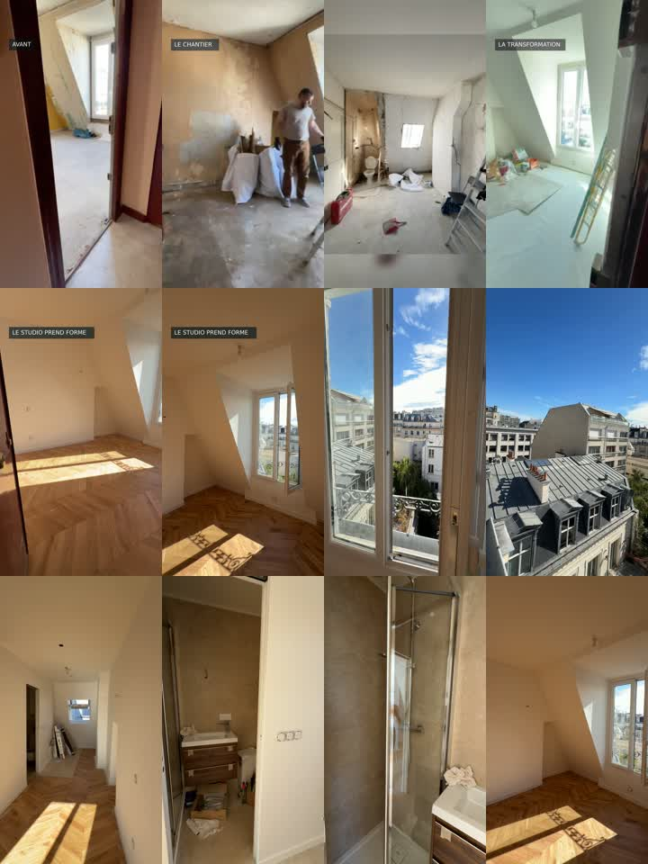

# Montage — rénovation du studio

[Vidéo MP4, 30 secondes](studio-renovation-2026-10-27/studio-renovation.mp4)

Montage réalisé le 27 octobre 2026, sauvegardé le 28 octobre 2026.
Dix plans, 1080 × 1920, 30 fps, H.264, sans bande-son. Quatre photos puis six extraits du rush fourni. Les images montrent le chantier et un stade avancé avec finitions encore en cours.

Le dossier contient le MP4, un aperçu, la liste des plans, le script Python/FFmpeg et les empreintes SHA-256.

## Reprendre le montage

Les originaux ne sont pas inclus. Placer les cinq fichiers sources dans `studio-renovation-2026-10-27/sources/`, avec les noms indiqués dans `montage.json`. Avec Python 3, FFmpeg (libx264, drawtext) et la police DejaVu Sans disponibles, exécuter `python3 studio-renovation-2026-10-27/render.py`. Le script recrée les segments et remplace le MP4 de sortie.

Contrôles effectués : décodage complet sans erreur, dimensions et durée avec ffprobe, inspection de la planche-contact. Pas de contrôle en lecture temps réel sur téléphone.
